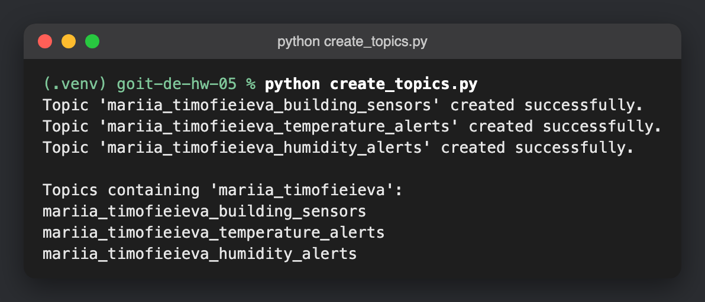
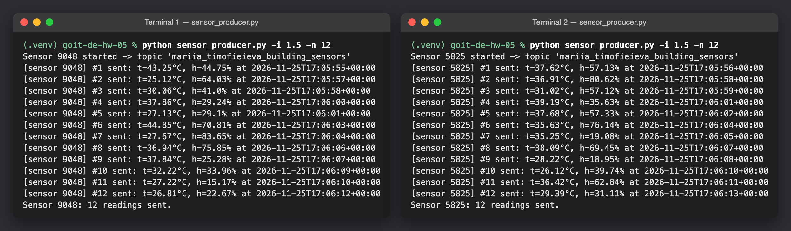
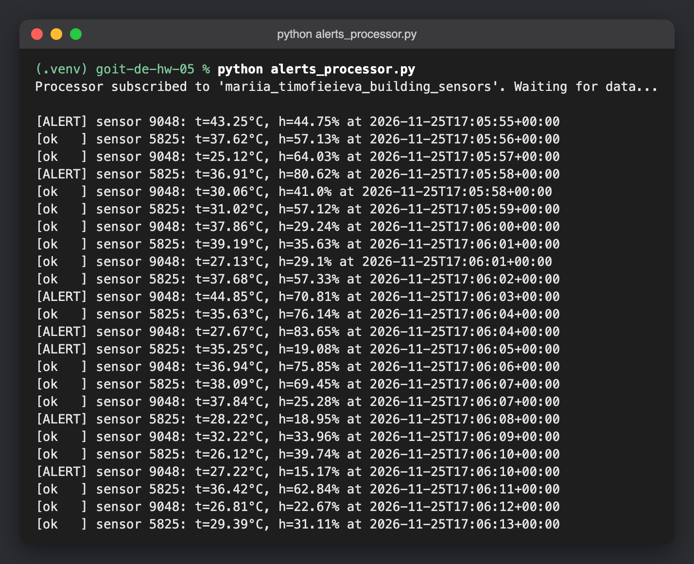
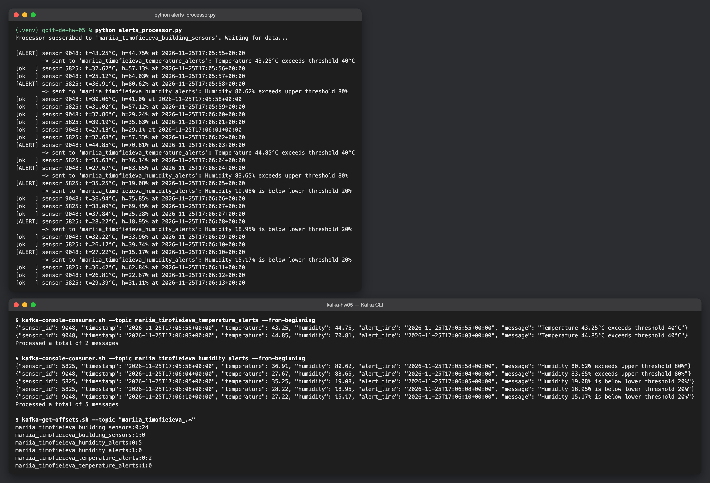
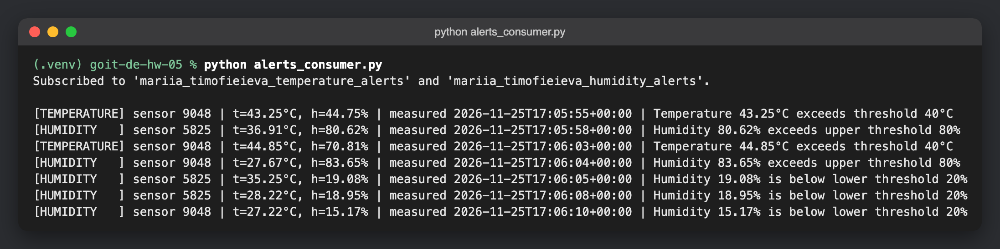

Система збирає показники температури й вологості з датчиків у будівлях, перевіряє їх у реальному часі
та надсилає сповіщення про перевищення порогових значень. Обмін повідомленнями йде через Apache Kafka (Python, `kafka-python`).

```
sensor_producer.py (×N) ──► building_sensors ──► alerts_processor.py ──┬─► temperature_alerts ──┐
                                                                        └─► humidity_alerts ─────┴─► alerts_consumer.py
```

## Структура

| Файл | Призначення |
|---|---|
| [configs.py](configs.py) | Параметри підключення до Kafka, імена топіків, порогові значення, (де)серіалізатори JSON |
| [create_topics.py](create_topics.py) | Крок 1: створення трьох топіків і виведення їх списку |
| [sensor_producer.py](sensor_producer.py) | Крок 2: імітація одного датчика, відправка даних у `building_sensors` |
| [alerts_processor.py](alerts_processor.py) | Кроки 3–4: читання `building_sensors`, фільтрація, відправка сповіщень |
| [alerts_consumer.py](alerts_consumer.py) | Крок 5: читання `temperature_alerts` і `humidity_alerts`, виведення на екран |
| [docker-compose.yml](docker-compose.yml) | Локальний брокер Kafka (KRaft) на `localhost:9092` |

Щоб імена топіків не дублювалися, до них додано префікс `mariia_timofieieva_`:
`mariia_timofieieva_building_sensors`, `mariia_timofieieva_temperature_alerts`, `mariia_timofieieva_humidity_alerts`.

## Запуск

```bash
python3 -m venv .venv && source .venv/bin/activate
pip install -r requirements.txt
docker compose up -d                # локальна Kafka
python create_topics.py             # крок 1
```

Далі в окремих терміналах:

```bash
python alerts_processor.py          # кроки 3–4
python alerts_consumer.py           # крок 5
python sensor_producer.py           # датчик №1
python sensor_producer.py           # датчик №2 (одночасно з першим)
```

Для віддаленого брокера задайте змінні середовища `KAFKA_BOOTSTRAP_SERVERS`, `KAFKA_SECURITY_PROTOCOL`
(наприклад, `SASL_PLAINTEXT`), `KAFKA_SASL_MECHANISM`, `KAFKA_USERNAME`, `KAFKA_PASSWORD`.

## Опис виконання

### 1. Створення топіків

[create_topics.py](create_topics.py) створює три топіки (2 партиції, replication factor 1) через `KafkaAdminClient`
і виводить їх командою `[print(topic) for topic in admin_client.list_topics() if "mariia_timofieieva" in topic]`.



### 2. Генерація даних датчиків

Один запуск [sensor_producer.py](sensor_producer.py) відповідає одному датчику: ID — випадкове число від 1000 до 9999,
постійне в межах запуску. Кожні 2 секунди датчик надсилає JSON-повідомлення (ключ — ID датчика):

```json
{"sensor_id": 9048, "timestamp": "2026-11-25T17:05:55+00:00", "temperature": 43.25, "humidity": 44.75}
```

Температура — випадкова величина від 25 до 45, вологість — від 15 до 85.
На скриншоті два запуски працюють одночасно, з різними ID датчиків.



### 3. Отримання та фільтрація даних

[alerts_processor.py](alerts_processor.py) підписаний на `building_sensors` і перевіряє кожне повідомлення:
- температура > 40°C — сповіщення для `temperature_alerts`;
- вологість > 80% або < 20% — сповіщення для `humidity_alerts`.

Показники без порушень позначено `[ok]`, а ті, що далі йдуть у топіки сповіщень, — `[ALERT]`.



### 4. Відправка відфільтрованих даних у топіки сповіщень

Для кожного порушення процесор формує сповіщення (ID датчика, показники, час вимірювання, час сповіщення, текст)
і надсилає його у відповідний топік. Рядок `-> sent to '<topic>'` підтверджує відправку.
У нижньому вікні скриншота вміст топіків сповіщень прочитано безпосередньо з Kafka (`kafka-console-consumer.sh`):
2 повідомлення в `temperature_alerts` і 5 у `humidity_alerts`.
Якщо одне вимірювання порушує обидва пороги, надсилаються два сповіщення.

```json
{"sensor_id": 5825, "timestamp": "2026-11-25T17:06:05+00:00", "temperature": 35.25, "humidity": 19.08,
 "alert_time": "2026-11-25T17:06:05+00:00", "message": "Humidity 19.08% is below lower threshold 20%"}
```



### 5. Читання сповіщень

[alerts_consumer.py](alerts_consumer.py) підписаний одразу на `temperature_alerts` і `humidity_alerts`
та виводить кожне сповіщення з міткою топіка.


